<div align="center">

# 🌀 NeuroSD

### A Neural Spectral Dynamics Framework for Complex Spatio-temporal Sequence Prediction

Spectral dependency modeling · Dynamic temporal memory · Continuous latent evolution

[Overview](#overview) · [Datasets](#datasets) · [Installation](#installation) · [Training](#training) · [Results](#results)

</div>

---

> **TL;DR:** NeuroSD aggregates spectrally enhanced historical features into an initial latent state and evolves that state with a Neural ODE to predict future observations.

## Overview

NeuroSD is a PyTorch framework for multi-step spatiotemporal prediction. It combines local spatial representations, global spectral dependencies, historical memory aggregation, and continuous-time latent state evolution.

The framework is evaluated on MovingMNIST, TaxiBJ, and three Navier–Stokes benchmark settings: T20, T30, and T50.

<div align="center">
  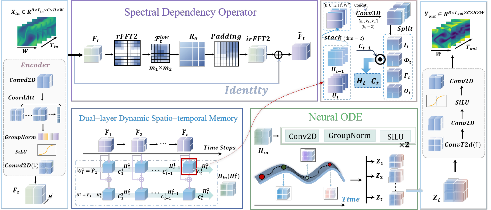
  <br>
  <em>Overall architecture of NeuroSD.</em>
</div>

[View the original PDF](figures/model.pdf)

### Framework components

| Component | Role |
| :--- | :--- |
| Encoder | Extracts local spatial features and positional information from historical observations. |
| Spectral Dependency Operator (SDO) | Applies an FNO-style spectral transformation and fuses global spectral features with local features through a residual connection. |
| Dual-layer Dynamic Spatiotemporal Memory (DyMem) | Aggregates spectrally enhanced historical features through two layers of gated recurrent updates and interlayer residual connections. |
| Neural ODE | Evolves the latent state initialized by the final historical hidden state. |
| Decoder | Maps future latent states to predictions in the observation space. |

### Prediction procedure

1. Encode each input frame into a latent spatial representation.
2. Enhance the representation with the SDO.
3. Aggregate the historical representations with DyMem.
4. Use the final hidden state as the initial condition for future latent evolution.
5. Integrate the Neural ODE at the future prediction times.
6. Decode the future latent states into predicted observations.

The initial condition is

$$
Z(0)=H_{T_{\mathrm{in}}}.
$$

For regularly sampled sequences, the normalized prediction times are

$$
\tau_k=\frac{k}{T_{\mathrm{out}}},
\qquad k=1,\ldots,T_{\mathrm{out}}.
$$

The main configuration uses RK4. With one RK4 step between consecutive prediction times, the step size is

$$
h=\frac{1}{T_{\mathrm{out}}}.
$$

---

## Repository organization

The main implementation and configuration paths are:

| Path | Description |
| :--- | :--- |
| `openstl/models/neurosd_model.py` | NeuroSD model implementation. |
| `openstl/methods/neurosd.py` | Training, validation, and evaluation logic. |
| `openstl/datasets/` | Dataset loaders and data-loading utilities. |
| `openstl/utils/experiment_log.py` | Experiment metadata, runtime measurements, and result logging. |
| `configs/mmnist/NeuroSD.py` | MovingMNIST configuration. |
| `configs/taxibj/NeuroSD.py` | TaxiBJ configuration. |
| `configs/navier_stokes_t20/NeuroSD.py` | Navier–Stokes T20 configuration. |
| `configs/navier_stokes_t30/NeuroSD.py` | Navier–Stokes T30 configuration. |
| `configs/navier_stokes_t50/NeuroSD.py` | Navier–Stokes T50 configuration. |
| `tools/train.py` | Training entry point. |
| `figures/` | Manuscript figures and their README previews. |
| `environment.yml` | Environment specification. |

PNG files are used for inline previews. The corresponding PDF files retain the original manuscript figure names and are linked below each preview.

---

## Datasets

The experiments cover video prediction, traffic flow prediction, and vorticity-field prediction.

| Dataset | Task | Training size | Test size | Channels | Spatial size | Input frames | Prediction frames |
| :--- | :--- | ---: | ---: | ---: | :---: | ---: | :---: |
| MovingMNIST | Video prediction | 10,000 | 10,000 | 1 | 64 × 64 | 10 | 10 |
| TaxiBJ | Traffic inflow and outflow prediction | 20,461 | 500 | 2 | 32 × 32 | 4 | 4 |
| Navier–Stokes T20 | Vorticity prediction | 960 | 240 | 1 | 64 × 64 | 10 | 10 |
| Navier–Stokes T30 | Vorticity prediction | 8,000 | 2,000 | 1 | 64 × 64 | 10 | 10 |
| Navier–Stokes T50 | Vorticity and long-term prediction | 1,600 | 400 | 1 | 64 × 64 | 10 | 10 / 20 / 25 / 30 |

MovingMNIST training sequences are generated online. Its training size denotes the number of generated training samples per epoch.

### Dataset access

Dataset files associated with this project are available through:

[NeuroSD datasets on Hugging Face](https://huggingface.co/datasets/Xiao1117/NeuroSD/tree/main)

The datasets originate from their respective authors and maintainers. Please consult and cite the original dataset sources and follow their licenses and usage conditions.

### Data paths

MovingMNIST and TaxiBJ use the following paths relative to `data_root`:

```text
data/moving_mnist/train-images-idx3-ubyte.gz
data/moving_mnist/mnist_test_seq.npy
data/taxibj/dataset.npz
```

For each Navier–Stokes configuration, set `ns_data_file` to the actual local MAT/HDF5 file.

The configuration names are:

```python
dataname = "navier_stokes_t20"
dataname = "navier_stokes_t30"
dataname = "navier_stokes_t50"
```

Set `ns_axis_order` according to the stored dimensions of the actual file. The model receives sequences with shape:

```text
[batch, time, channel, height, width]
```

### Preprocessing protocol

| Dataset | Preprocessing |
| :--- | :--- |
| MovingMNIST | Divide pixel values by 255. Generate training sequences online and evaluate on fixed test sequences. |
| TaxiBJ | Load the stored training and test arrays from `dataset.npz`, then apply `(value + 1) / 2`. |
| Navier–Stokes T20 | Fit min–max statistics on training trajectories and apply the same statistics to training and test data. |
| Navier–Stokes T30 | Use trajectories `[0:8000]` for training and `[8000:10000]` for testing. Fit min–max statistics on the training trajectories only. |
| Navier–Stokes T50 | Use trajectories `[0:1600]` for training and `[1600:2000]` for testing. Fit min–max statistics on the first 20 frames of the training trajectories. |

Trajectory and frame ranges use Python slicing: the start index is included and the stop index is excluded.

For T50 long-term prediction, retain the same 10-frame inputs, trajectory split, and normalization statistics. Extract targets from frames `[10:10+T_out]`.

---

## Installation

Clone the repository:

```bash
git clone https://github.com/16lyx/NeuroSD.git
cd NeuroSD
```

Create and activate the environment:

```bash
conda env create -n neurosd -f environment.yml
conda activate neurosd
```

Verify that PyTorch can access the intended GPU:

```bash
python -c "import torch; print(torch.__version__); print(torch.cuda.is_available())"
```

Before training, update the local dataset paths in the configuration files.

---

## Training

Run the following commands from the repository root.

### MovingMNIST

```bash
python -u tools/train.py \
    --config_file configs/mmnist/NeuroSD.py \
    --method neurosd \
    --dataname mmnist \
    --data_root ./data \
    --res_dir ./work_dirs \
    --ex_name mmnist/NeuroSD_seed42 \
    --device cuda \
    --seed 42 \
    --deterministic
```

### TaxiBJ

```bash
python -u tools/train.py \
    --config_file configs/taxibj/NeuroSD.py \
    --method neurosd \
    --dataname taxibj \
    --data_root ./data \
    --res_dir ./work_dirs \
    --ex_name taxibj/NeuroSD_seed42 \
    --device cuda \
    --seed 42 \
    --deterministic
```

### Navier–Stokes T20

```bash
python -u tools/train.py \
    --config_file configs/navier_stokes_t20/NeuroSD.py \
    --method neurosd \
    --dataname navier_stokes_t20 \
    --data_root ./data \
    --res_dir ./work_dirs \
    --ex_name navier_stokes_t20/NeuroSD_seed42 \
    --device cuda \
    --seed 42 \
    --deterministic
```

### Navier–Stokes T30

```bash
python -u tools/train.py \
    --config_file configs/navier_stokes_t30/NeuroSD.py \
    --method neurosd \
    --dataname navier_stokes_t30 \
    --data_root ./data \
    --res_dir ./work_dirs \
    --ex_name navier_stokes_t30/NeuroSD_seed42 \
    --device cuda \
    --seed 42 \
    --deterministic
```

### Navier–Stokes T50

```bash
python -u tools/train.py \
    --config_file configs/navier_stokes_t50/NeuroSD.py \
    --method neurosd \
    --dataname navier_stokes_t50 \
    --data_root ./data \
    --res_dir ./work_dirs \
    --ex_name navier_stokes_t50/NeuroSD_seed42 \
    --device cuda \
    --seed 42 \
    --deterministic
```

Each command above launches one run with seed 42. A single run does not reproduce the three-run means reported in the main benchmark table. Run each required seed separately and aggregate the resulting metrics.

Use distinct experiment names for different seeds, prediction horizons, and ablation configurations.

---

## Main experiment configurations

| Dataset | Hidden channels | Fourier modes | Batch size | Epochs | Learning rate | Scheduler |
| :--- | ---: | :---: | ---: | ---: | :---: | :--- |
| MovingMNIST | 128 | (2, 3) | 16 | 200 | 1e-3 | OneCycleLR |
| TaxiBJ | 256 | (3, 3) | 32 | 200 | 1e-4 | OneCycleLR |
| Navier–Stokes T20 | 256 | (2, 3) | 8 | 50 | 1e-4 | Cosine |
| Navier–Stokes T30 | 128 | (3, 5) | 8 | 50 | 1e-4 | Cosine |
| Navier–Stokes T50 | 128 | (3, 5) | 8 | 50 | 1e-4 | Cosine |

Shared main-experiment settings:

- Optimizer: AdamW.
- Training loss: elementwise MSE + `0.2 × (1 − SSIM)`.
- ODE solver: RK4.
- Normalized ODE interval: `[0, 1]`.
- Training precision: FP32.
- DataLoader workers: 4.

The main-experiment table reports benchmark configurations. Auxiliary experiments should retain their own recorded settings.

---

## Evaluation protocol

The main metrics are MSE, MAE, SSIM, and PSNR.

| Metric | Prediction clipping | Calculation |
| :--- | :---: | :--- |
| MSE ↓ | None | Sum squared errors over channels and spatial locations, then average over samples and prediction steps. |
| MAE ↓ | None | Sum absolute errors over channels and spatial locations, then average over samples and prediction steps. |
| SSIM ↑ | `[0,1]` | Use a 7 × 7 window and `data_range=1`. Average over channels, samples, and prediction steps. |
| PSNR ↑ | `[0,1]` | Compute PSNR for each frame using `data_range=1`, then average over samples and prediction steps. |

Ground-truth values are not clipped.

Reported MSE and MAE use the post-preprocessing dataset scales. They are not directly comparable across datasets.

Training MSE averages over all elements. For the same predictions and targets:

```text
reported MSE = elementwise MSE × C × H × W
reported MAE = elementwise MAE × C × H × W
```

SSIM used in the training loss and SSIM used for evaluation are implemented separately. The training loss uses `pytorch_msssim`, while evaluation uses the protocol above.

For Navier–Stokes physics-related analyses, use the data scale specified for each metric in the manuscript. Denormalization requires the statistics saved by the corresponding dataset loader.

---

## Results

### Main benchmark summary

The following table shows the NeuroSD means from the manuscript's three-run main comparison. Standard deviations and full baseline comparisons are reported in the manuscript.

| Dataset | MSE ↓ | MAE ↓ | SSIM ↑ | PSNR (dB) ↑ |
| :--- | ---: | ---: | ---: | ---: |
| MovingMNIST | 22.77790 | 65.3303 | 0.94802 | 23.095 |
| TaxiBJ | 0.29998 | 14.7913 | 0.97914 | 39.587 |
| Navier–Stokes T20 | 6.64536 | 100.5291 | 0.89052 | 30.928 |
| Navier–Stokes T30 | 0.13519 | 14.6809 | 0.99548 | 47.848 |
| Navier–Stokes T50 | 0.01169 | 4.2404 | 0.99985 | 57.692 |

NeuroSD achieves the lowest mean MSE and the highest mean SSIM across the five benchmark settings in the current manuscript. PSNR rankings depend on the dataset.

### Radar comparisons

<div align="center">
  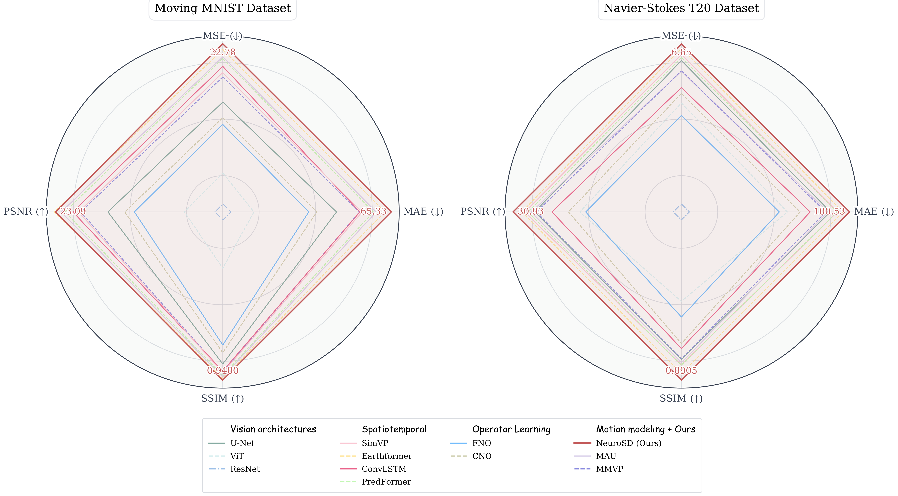
</div>

[View the original PDF](figures/MMNIST_N20_radar.pdf)

<div align="center">
  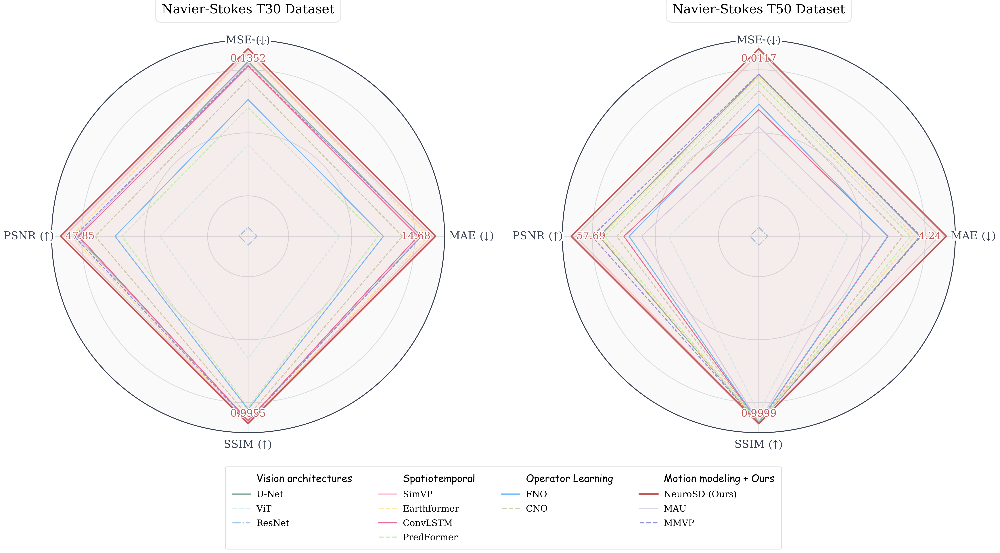
</div>

[View the original PDF](figures/N-30_N-50_radar.pdf)

---

## Qualitative predictions

### MovingMNIST

<div align="center">
  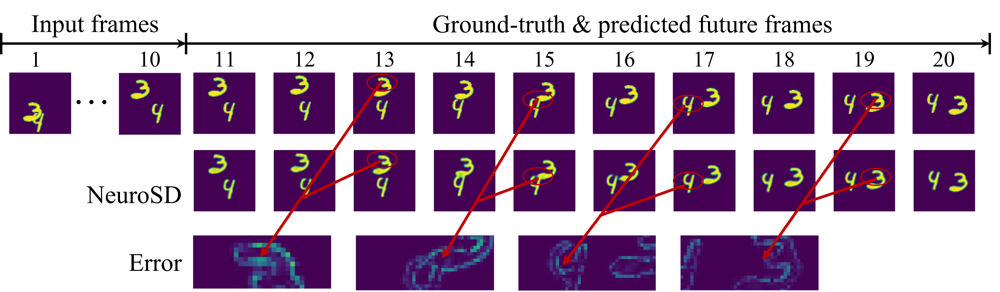
  <br>
  <em>Ground truth, NeuroSD predictions, and highlighted prediction errors on MovingMNIST.</em>
</div>

[View the original PDF](figures/NeuroSD_MMNIST.pdf)

<details>
<summary>Comparison with baseline models</summary>


[View the original PDF](figures/ALL_MMNIST.pdf)

</details>

### TaxiBJ

<div align="center">
  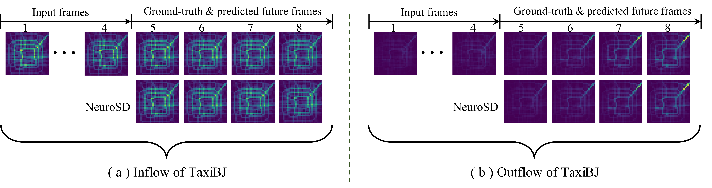
  <br>
  <em>Traffic inflow and outflow predictions on TaxiBJ.</em>
</div>

[View the original PDF](figures/NeuroSD_TaxiBJ.pdf)

<details>
<summary>Comparison with baseline models</summary>

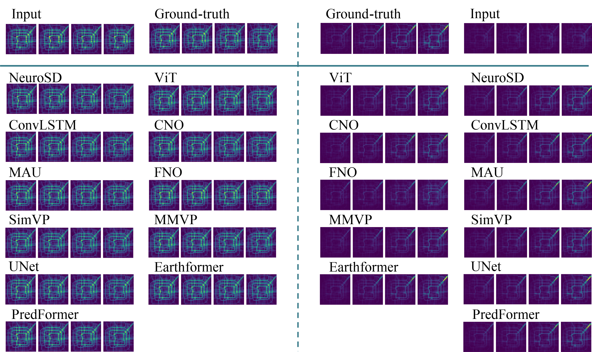

[View the original PDF](figures/ALL_TaxiBJ.pdf)

</details>

### Navier–Stokes

<div align="center">
  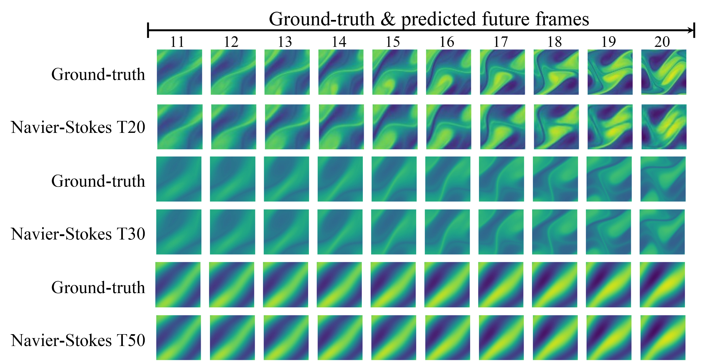
  <br>
  <em>Vorticity-field predictions on Navier–Stokes T20, T30, and T50.</em>
</div>

[View the original PDF](figures/NeuroSD_NS.pdf)

<details>
<summary>Baseline comparison on T20</summary>


[View the original PDF](figures/ALL_NS-20.pdf)

</details>

<details>
<summary>Baseline comparison on T30</summary>


[View the original PDF](figures/ALL_NS-30.pdf)

</details>

<details>
<summary>Baseline comparison on T50</summary>


[View the original PDF](figures/ALL_NS-50.pdf)

</details>

ResNet is included in the quantitative comparisons but omitted from the manuscript's visual comparisons because of its relatively large prediction errors.

---

## Long-term prediction

We evaluate 10-, 20-, 25-, and 30-step prediction on Navier–Stokes T50 while keeping the input length fixed at 10 frames.

Each prediction horizon uses a separately trained model and its corresponding checkpoint. The long-term results use seed 42 and are reported separately from the three-run main benchmark means.

### NeuroSD performance across horizons

| Input frames | Prediction frames | MSE ↓ | MAE ↓ | SSIM ↑ | PSNR (dB) ↑ |
| ---: | ---: | ---: | ---: | ---: | ---: |
| 10 | 10 | 0.01156 | 4.2078 | 0.99983 | 57.761 |
| 10 | 20 | 0.02740 | 7.1257 | 0.99965 | 53.331 |
| 10 | 25 | 0.04708 | 9.7593 | 0.99938 | 49.897 |
| 10 | 30 | 0.05462 | 10.8579 | 0.99930 | 49.630 |

The 10-step result in this table comes from the single-seed horizon experiment. It is not the three-run mean in the main benchmark summary.

### Horizon settings

| Input frames | `aft_seq_length` | `total_length` |
| ---: | ---: | ---: |
| 10 | 10 | 20 |
| 10 | 20 | 30 |
| 10 | 25 | 35 |
| 10 | 30 | 40 |

Keep `in_shape = [10, 1, 64, 64]` and `ns_normalization_frames = 20` for these T50 experiments.

For example, launch a 30-step run with:

```bash
python -u tools/train.py \
    --config_file configs/navier_stokes_t50/NeuroSD.py \
    --method neurosd \
    --dataname navier_stokes_t50 \
    --data_root ./data \
    --res_dir ./work_dirs \
    --ex_name navier_stokes_t50/NeuroSD_10to30_seed42 \
    --device cuda \
    --pre_seq_length 10 \
    --aft_seq_length 30 \
    --total_length 40 \
    --seed 42 \
    --deterministic
```

### Predictions at different horizons

<div align="center">
  
</div>

[View the original PDF](figures/NeuroSD_N-50_long.pdf)

### Comparison at 30 prediction steps

<div align="center">
  
</div>

[View the original PDF](figures/ALL_N-50_long_30.pdf)

### Per-step MSE

<div align="center">
  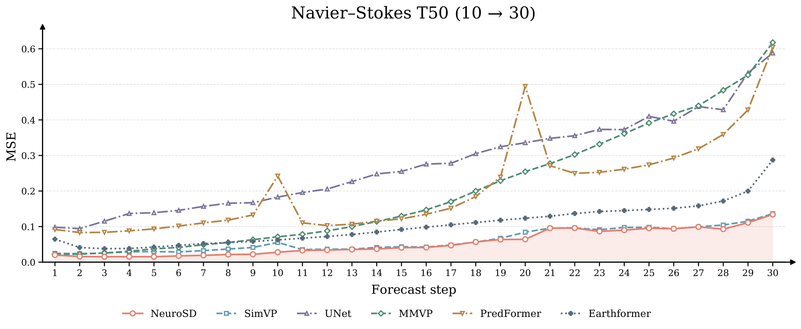
</div>

[View the original PDF](figures/N50_10to30_stepwise_MSE.pdf)

<details>
<summary>Comparison at 20 prediction steps</summary>


[View the original PDF](figures/ALL_N-50_long_20.pdf)

</details>

<details>
<summary>Comparison at 25 prediction steps</summary>

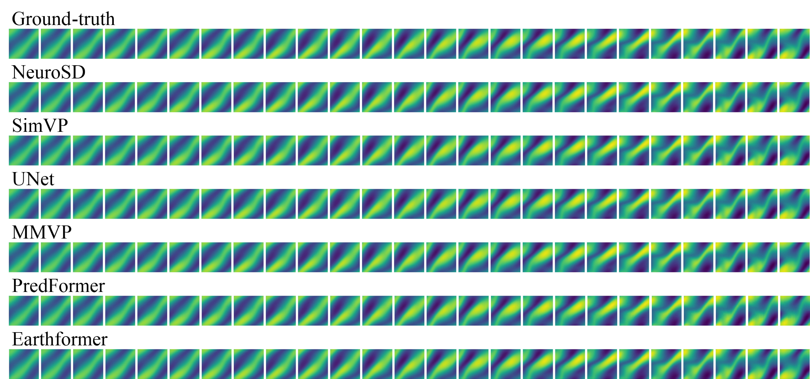

[View the original PDF](figures/ALL_N-50_long_25.pdf)

</details>

---

## Ablation studies

The manuscript evaluates the following configurations to examine the contribution of the core modules:

| Configuration | Description |
| :--- | :--- |
| Full NeuroSD | Uses spectral enhancement, DyMem, and Neural ODE evolution. |
| w/o SDO | Removes spectral dependency modeling. |
| w/o DyMem | Removes the dual-layer dynamic spatiotemporal memory module. |
| Neural ODE → Discrete | Replaces continuous-time evolution with discrete residual updates. |
| Neural ODE → ConvGRU | Replaces the Neural ODE module with a ConvGRU-based alternative. |

The T20 and T30 ablation studies use seed 42.

### Quantitative comparison

<div align="center">
  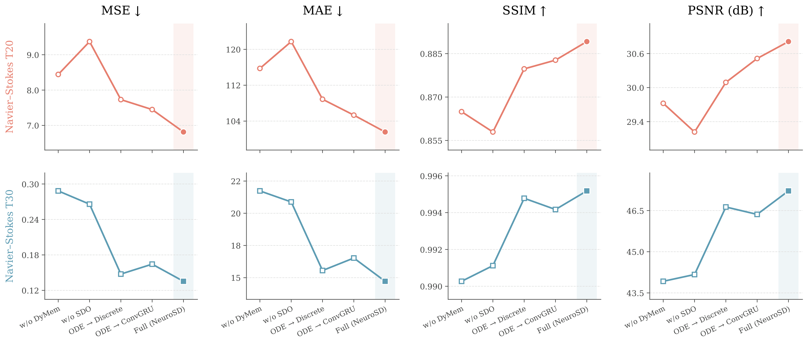
</div>

[View the original PDF](figures/ablation_N20_N30_zhexian.pdf)

### Qualitative comparison on T20

<div align="center">
  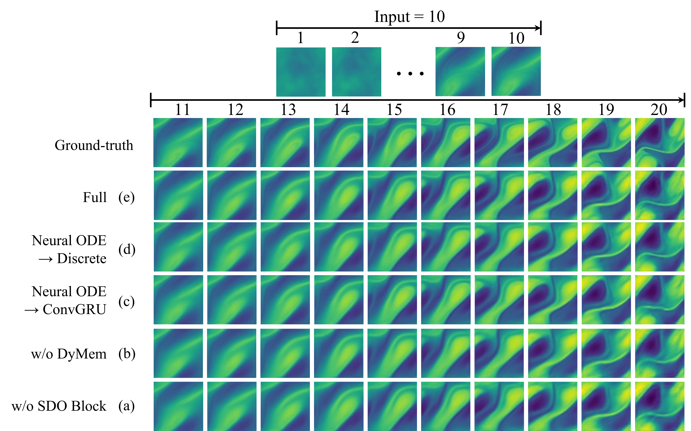
</div>

[View the original PDF](figures/NeuroSD_N-20_W_O.pdf)

### Qualitative comparison on T30

<div align="center">
  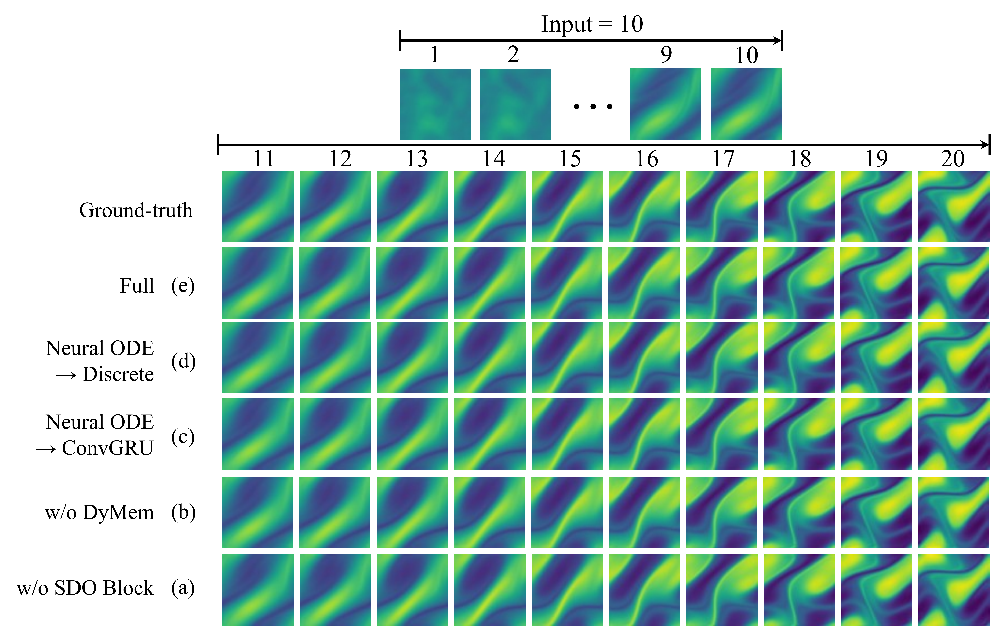
</div>

[View the original PDF](figures/NeuroSD_N-30_W_O.pdf)

---

## Hyperparameter sensitivity

We analyze the effects of latent channel counts, retained Fourier modes, and the SSIM loss weight on Navier–Stokes T20.

### Latent channels and Fourier modes

<div align="center">
  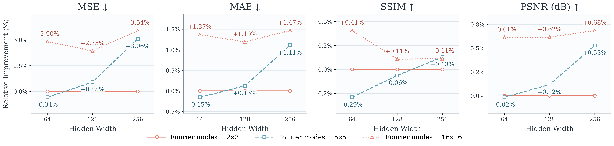
</div>

[View the original PDF](figures/Hyperparameter_Sensitivity.pdf)

### SSIM loss weight

<div align="center">
  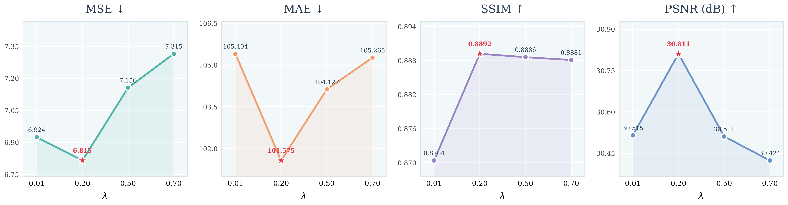
</div>

[View the original PDF](figures/Lambda_Sensitivity.pdf)

---

## Physics-related evaluation

The manuscript supplements image-space metrics with:

- Scalar spectral error.
- Relative gradient error.
- Relative field L2 error.
- Relative temporal increment error.

These metrics assess spectral distributions, spatial gradients, field values, and frame-to-frame changes. Their definitions and data scales are specified in Appendix E of the manuscript.

### Navier–Stokes T50

<details>
<summary>Spatial gradient comparison</summary>


[View the original PDF](figures/ALL_N-50_gradient.pdf)

</details>

<details>
<summary>Log power spectrum comparison</summary>


[View the original PDF](figures/ALL_N-50_LogPower.pdf)

</details>

### TaxiBJ

<details>
<summary>Spatial gradient comparison</summary>

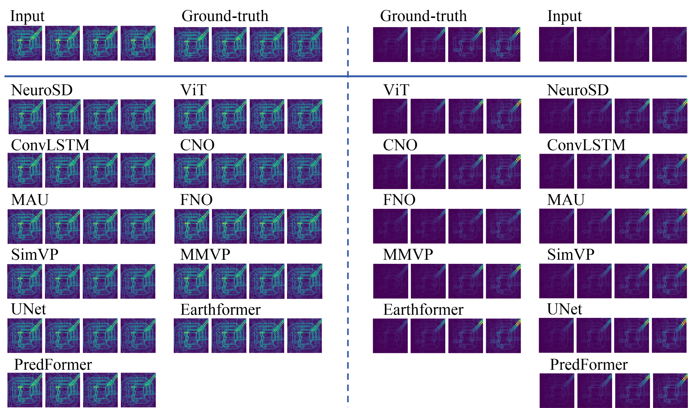

[View the original PDF](figures/ALL_taxibj_gradient.pdf)

</details>

<details>
<summary>Log power spectrum comparison</summary>

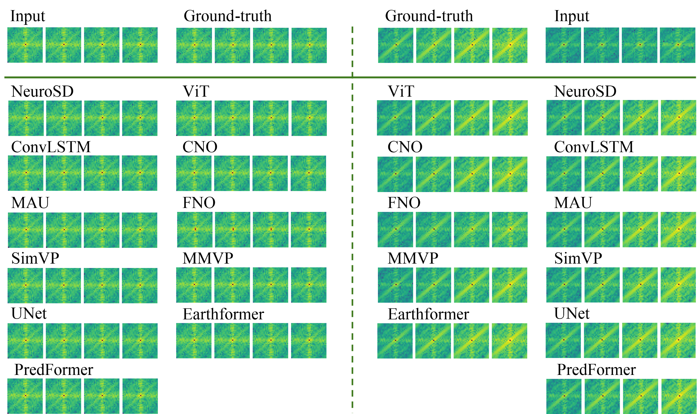

[View the original PDF](figures/ALL_taxibj_LogPower.pdf)

</details>

---

## Experiment outputs

The logging utilities record configuration, environment, metrics, and runtime information.

| File | Description |
| :--- | :--- |
| `config_resolved.json` | Resolved runtime arguments. |
| `environment.json` | Software, hardware, and reproducibility settings. |
| `data_protocol.json` | Dataset metadata and evaluation protocol. |
| `parameters.json` | Parameter counts, including separate complex-parameter accounting. |
| `optimizer_scheduler.json` | Optimizer and scheduler metadata. |
| `train_updates.csv` | Sampled optimizer-update records. |
| `train_epoch.csv` | Epoch-level training records. |
| `eval_epoch.csv` | Epoch-level evaluation records. |
| `best_record.json` | Best recorded selection metric and associated epoch. |
| `test_metrics.json` | Final evaluation summary. |
| `test_per_step.csv` | Final metrics at each prediction step. |
| `efficiency.json` | Forward latency and memory measurements. |
| `operation_count.json` | Supported operation counts and unsupported operators. |
| `file_manifest.json` | File hashes for recorded source and data files. |

When final prediction export is enabled, the evaluation code also writes:

```text
saved/inputs.npy
saved/preds.npy
saved/trues.npy
saved/npy_info.json
```

The saved sequence arrays use:

```text
[sample, time, channel, height, width]
```

Saved predictions are not clipped. Consult `npy_info.json` for the normalization metadata.

Final evaluation and profiling use the currently loaded model weights. Load the intended checkpoint before calling these routines.

### Efficiency measurement

Inference latency is measured with batch size 1 for a complete future sequence. The measurement excludes data loading, host-to-device transfer, and metric calculation.

GPU memory fields distinguish current allocation, reserved memory, and peak allocation. CPU process-tree RSS is a sampled value rather than a stage peak.

The operation-count report covers operators supported by the profiling tool. It should not be interpreted as a complete count of FFT, complex arithmetic, and solver operations.

---

## Reproducibility notes

- Main benchmark results and auxiliary experiments use different reporting protocols. Do not combine three-run means with single-seed ablation or horizon results.
- Fit normalization statistics using the training data specified for each dataset.
- Retain the normalization statistics when evaluating or exporting predictions.
- Verify the actual validation/test split in the dataset loader. Separate loader objects do not establish that their underlying samples are disjoint.
- Record any independent validation split used for checkpoint selection.
- Keep the model configuration, seed, training length, and evaluation protocol associated with each reported result.

---

## Acknowledgements and usage

This project uses the OpenSTL training framework and incorporates ideas and implementations from the original research on spectral operators, recurrent spatiotemporal modeling, and Neural ODEs.

We thank the authors and maintainers of the datasets, baseline implementations, and open-source tools used in this work.

The code and datasets may be subject to different licenses. Consult the applicable license files and original sources before reuse or redistribution. Dataset access through the linked Hugging Face repository does not replace the original dataset attribution and usage requirements.

[OpenSTL](https://github.com/chengtan9907/OpenSTL)

---

<div align="center">
  <sub>
    NeuroSD combines spectral spatial modeling, historical memory aggregation,
    and continuous-time latent evolution for multi-step spatiotemporal prediction.
  </sub>
</div>